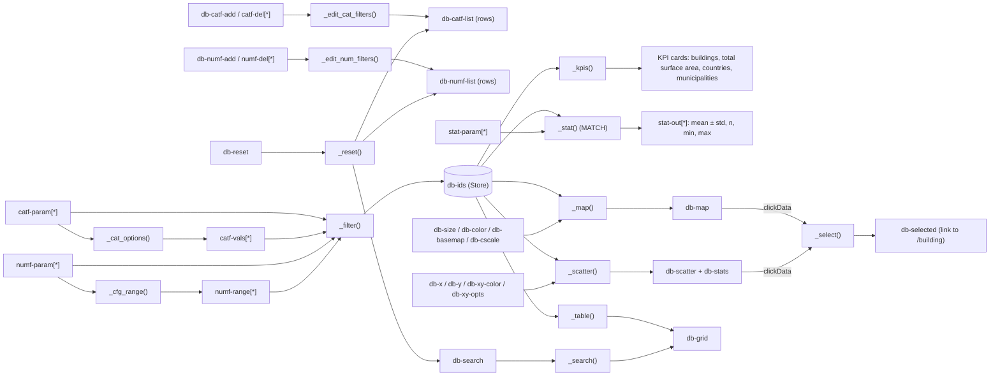

# Architecture

The app is a multi-page [Dash](https://dash.plotly.com/) application. Dash *pages* (`use_pages=True`) are
discovered automatically from the `pages/` folder; shared logic lives in `components/`.

```
app.py                  Dash app, navigation bar, page container (entry point; server = app.server)
pages/                  one module per page, each calls dash.register_page(...)
  home.py               "/"          Dashboard: KPIs, dynamic filters, bubble map, statistics, XY explorer, data table
  building.py           "/building"  Building detail (query string ?building_id=...)
  compare.py            "/compare"   Compare 2–6 buildings
  contribute.py         "/contribute" Contribute data (form / Excel template upload)
  about.py              "/about"     Frameworks, scales, sources, caveats
components/             shared, page-independent code
  data.py               Excel loading (cached, auto-reload on file change) + data-dictionary helpers
  figures.py            Plotly figure builders (map, scatter, bars, radar, heatmap)
  ui.py                 small layout helpers (card, control, kpi, graph)
  submissions.py        data contributions: template, validation, anti-spam, storage (SUBMISSIONS_DIR)
tools/                  maintenance scripts run by the maintainer (fetch_submissions.py)
assets/style.css        styling, auto-loaded by Dash
assets/favicon.ico      browser-tab icon (SINTEF), served automatically by Dash
assets/logos/           SINTEF and IBPSA Nordic logos (navigation bar), NSBI logo (About page)
data/                   the Excel dataset
docs/                   documentation and the project graph explorer
```

## Layers

1. **Data** – `components/data.py::get_data()` reads `data/smart_buildings_dataset.xlsx` into a `Dataset`
   (buildings, sri_detailed, data_dictionary, sources). The result is cached and reloaded when the file's
   modification time changes, so editing the Excel file + refreshing the browser is enough.
2. **Metadata-driven UI** – dropdown contents come from the `data_dictionary` sheet via `columns_for(flag)`
   and `dropdown_options(...)`. Labels, units and number formatting come from `label()`, `unit()`, `fmt()`.
   No column names are hard-coded in the dropdowns.
3. **Figures** – `components/figures.py` turns a (filtered) DataFrame into Plotly figures. Figure functions
   are pure: same input → same figure; they never read the dataset themselves except for labels.
4. **Pages** – each page defines `layout(**query_params)` (a function, so dropdown options are rebuilt on
   every page load) and its callbacks with `@callback`.

## Dashboard data flow (pages/home.py)

All filters feed a single callback, `_filter()`, which stores the ids of the matching buildings in a
`dcc.Store` (`#db-ids`). Every view (KPI cards, statistics cards, map, scatter, table) listens to that store,
so filtering logic exists in one place only.

### Dynamic filters (pattern-matching callbacks)

Category and numeric filters are lists of rows that the user can add (`+ Add …` buttons) and remove (✕).
Each row's components use dictionary ids, e.g. `{"type": "catf-param", "index": 3}`:

| Row type | Components (`type`) | Per-row callback (MATCH) |
|---|---|---|
| Category filter | `catf-row`, `catf-param`, `catf-vals`, `catf-del` | `_cat_options()`: parameter → value list |
| Numeric filter | `numf-row`, `numf-param`, `numf-range`, `numf-del` | `_cfg_range()`: parameter → slider min/max/step |

- `_edit_cat_filters()` / `_edit_num_filters()` append or delete rows with a `Patch` (other rows keep their state).
- `_cat_del_visibility()` / `_num_del_visibility()` hide the ✕ button when only one row is left, so at least
  one category and one numeric filter are always visible.
- `_filter()` reads all rows with `ALL` wildcards and combines them with AND.
- `_reset()` replaces both lists with one fresh row each.



For the complete, always up-to-date picture (all pages, all callbacks, every function call), open
[project_graph_explorer/NSBI_project_explorer.html](project_graph_explorer/NSBI_project_explorer.html).
In the explorer, pattern-matching components appear as one node per type, e.g. `#catf-param[*]`.

## Memory of user selections (per browser tab)

Selections are kept when moving between pages or reloading, using the browser's **sessionStorage**:

- Simple controls (map and plot dropdowns, statistics cards, table search, building / compare selections) use
  Dash persistence: `**PERSIST` from `components/ui.py` (`persistence=True, persistence_type="session"`).
- The dynamic filter rows of the dashboard cannot be restored by persistence (they are created by callbacks), so
  they are saved in `dcc.Store(id="mem-db-filters", storage_type="session")` in `app.py`:
  `_save_filters()` writes the rows (parameter + values / range) on every change, and `_restore_filters()` rebuilds
  them when the dashboard opens (triggered by `dcc.Store(id="db-init")`).

sessionStorage lives only in the browser: it is separate for every tab (two tabs never share selections, except
a tab created with "Duplicate tab", which starts as a copy), separate for every user and browser, never stored on
the server, and cleared when the tab is closed. "Reset filters" also resets the memory.

## Conventions

- Component ids are prefixed per page: `db-` (dashboard), `bd-` (building detail), `cmp-` (compare).
  Pattern-matching ids use a `type` key (`catf-…`, `numf-…`, `stat-…`) and an integer `index`.
- Callback functions are private (`_name`) and live in the page module that owns the components.
- Percentages are stored 0–100; SbP levels on the −2…4 scale; missing = empty cell (NaN), never 0.
- Adding a page: create `pages/<name>.py` with `dash.register_page(__name__, path=..., name=..., order=...)`
  and a `layout()` function. It appears in the navigation bar automatically.
- Adding a figure type: add a builder in `components/figures.py`, call it from a page callback.
