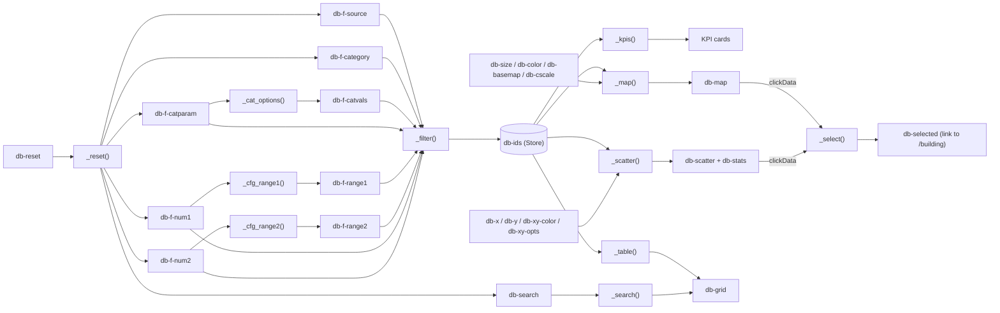

# Architecture

The app is a multi-page [Dash](https://dash.plotly.com/) application. Dash *pages* (`use_pages=True`) are
discovered automatically from the `pages/` folder; shared logic lives in `components/`.

```
app.py                  Dash app, navigation bar, page container (entry point; server = app.server)
pages/                  one module per page, each calls dash.register_page(...)
  home.py               "/"          Dashboard: filters, bubble map, XY correlation explorer, data table
  building.py           "/building"  Building detail (query string ?building_id=...)
  compare.py            "/compare"   Compare 2–6 buildings
  about.py              "/about"     Frameworks, scales, sources, caveats
components/             shared, page-independent code
  data.py               Excel loading (cached, auto-reload on file change) + data-dictionary helpers
  figures.py            Plotly figure builders (map, scatter, bars, radar, heatmap)
  ui.py                 small layout helpers (card, control, kpi, graph)
assets/style.css        styling, auto-loaded by Dash
data/                   the Excel dataset
docs/                   documentation and the project graph explorer
```

## Layers

1. **Data** – `components/data.py::get_data()` reads `data/smart_buildings_dataset.xlsx` into a `Dataset`
   (buildings, sri_detailed, data_dictionary, sources). The result is cached and reloaded when the file's
   modification time changes, so editing the Excel file + refreshing the browser is enough.
2. **Metadata-driven UI** – dropdown contents come from the `data_dictionary` sheet via `columns_for(flag)`
   and `dropdown_options(...)`. Labels, units and number formatting come from `label()`, `unit()`, `fmt()`.
   No column names are hard-coded in the dropdowns.
3. **Figures** – `components/figures.py` turns a (filtered) DataFrame into Plotly figures. Figure functions
   are pure: same input → same figure; they never read the dataset themselves except for labels.
4. **Pages** – each page defines `layout(**query_params)` (a function, so dropdown options are rebuilt on
   every page load) and its callbacks with `@callback`.

## Dashboard data flow (pages/home.py)

All filters feed a single callback, `_filter()`, which stores the ids of the matching buildings in a
`dcc.Store` (`#db-ids`). Every view (KPI cards, map, scatter, table) listens to that store, so filtering
logic exists in one place only.



For the complete, always up-to-date picture (all pages, all 14 callbacks, every function call), open
[project_graph_explorer/NSBI_project_explorer.html](project_graph_explorer/NSBI_project_explorer.html).

## Conventions

- Component ids are prefixed per page: `db-` (dashboard), `bd-` (building detail), `cmp-` (compare).
- Callback functions are private (`_name`) and live in the page module that owns the components.
- Percentages are stored 0–100; SbP levels on the −2…4 scale; missing = empty cell (NaN), never 0.
- Adding a page: create `pages/<name>.py` with `dash.register_page(__name__, path=..., name=..., order=...)`
  and a `layout()` function. It appears in the navigation bar automatically.
- Adding a figure type: add a builder in `components/figures.py`, call it from a page callback.
